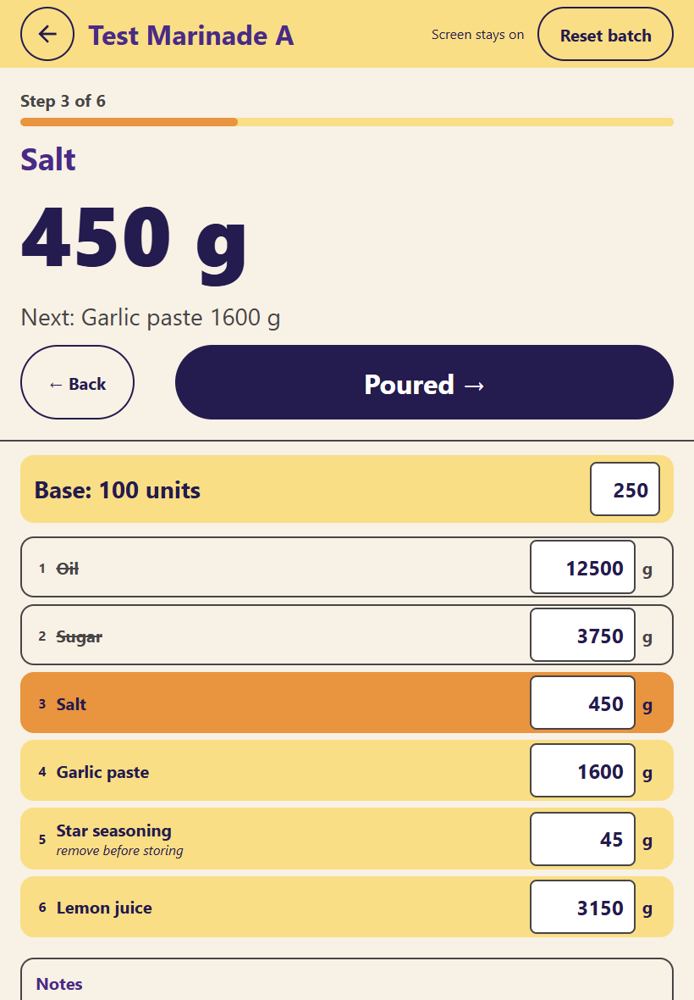

# Marinade Cook

[](https://github.com/nicodegiorgis/marinade-cook/actions/workflows/test.yml)

An offline web app for scaling and cooking bulk marinade batches. It works on a tablet, phone or computer. It has a recipe list, a split-view recipe page (live scaling on one side, step-by-step cook mode on the other), and recipes imported from your own recipe file (a .json file) that never leaves the device.

The full product spec is in [docs/spec.md](docs/spec.md).

## Screenshots

Live app: https://nicodegiorgis.github.io/marinade-cook/

All screenshots use the made-up recipes in `sample-recipes.json`.


First run: import a recipe file from Files.


Recipe list, A to Z, with search.


Recipe page at the base yield, units box empty.


Scaled to 250 units, cook mode on step 3 with the first two ingredients poured.


The same batch in the dark theme.



Portrait: cook mode on top, amounts below.

## Public code, private data

This repo is public and contains **only the app**. It ships with no recipes: you supply your own recipe file (a .json file), keep it on your own devices and move it to the device directly (for example by AirDrop or a USB cable). Any file name works, because the app checks only the contents, not the name. The app stores imported recipes only in that device's local browser storage and makes no network requests at all.

- If you clone the repo, keep your private recipe file outside the repo folder, or name it `recipes.json` or `something.private.json`. Those two patterns are gitignored, so the file is never committed. Any other name inside the folder is not protected.
- `sample-recipes.json` holds made-up recipes for development and testing.

### Privacy limits

- Recipes are stored only in this browser's local storage on the device and are never sent anywhere.
- Browser storage belongs to a site's origin. On GitHub Pages every project site under the same account shares one origin (`username.github.io`), so another site hosted under the same account could read the stored recipes. If you host this app next to other sites, serve it from its own origin, for example a custom domain or a separate GitHub organisation.
- The Content Security Policy is set with a meta tag, which cannot restrict who may embed the app in a frame, and GitHub Pages cannot send that header. The app has no sensitive actions, so the worst case is a tricked tap on **Reset batch**, which asks for confirmation once progress exists.

## Install

1. On the device, open the live app in the browser: https://nicodegiorgis.github.io/marinade-cook/
2. Install it as an app:
   - **iPad or iPhone (Safari):** tap Share → **Add to Home Screen**.
   - **Android (Chrome):** open the menu → **Add to Home screen** or **Install app**.
   - **Computer (Chrome or Edge):** click the install icon in the address bar.
3. Get a recipe file ready. The app comes with no recipes. You need a recipe file in the format described under [Recipe file format](#recipe-file-format) below. To try the app first, download [`sample-recipes.json`](sample-recipes.json) from this repo (made-up data) and import that.
4. Open the installed app and tap **Import recipes** to pick your recipe file.
   On iPad and iPhone, the Home Screen app has its own storage, separate from Safari, so importing in a Safari tab does not carry over. Import from the Home Screen icon.
5. Turn on airplane mode (or go offline) and check it still opens.

Uninstalling the app erases its recipes. Keep your recipe file somewhere safe so you can import it again.

## Using it

- **List:** every recipe A to Z. Search filters as you type.
- **Recipe page:** the top row shows the base yield ("Base: 100 units") and an empty units box. Leave it empty for the base recipe, type a number of units, **or** type the amount you have of any ingredient, and every other amount rescales. Typing an ingredient amount fills the units box with the units it makes (rounded down). At base, every amount is the exact value from the file. Once you type, amounts are rounded up (1 g under 20 g, 5 g up to 199 g, 10 g up to 1999 g, 50 g from 2000 g), and the box you typed in keeps your exact value.
- Every amount is in grams, shown as a plain number (`5000 g`, `1250 g`). Typing `1200` in an ingredient box means 1200 g. A comma works as the decimal point.
- **Cook mode:** tap **Poured** after each ingredient. **Back** steps back one. Tapping an ingredient's name in the list jumps straight to it.
- **Reset batch** clears progress, returns to the base yield and empties the units box. Progress and amounts are saved per recipe, so closing the app resumes the batch.
- **Settings** (the menu button on the list) shows the recipe count, import date and app version, lets you import a new file, and has a **Theme** choice: Auto (follows the device's light or dark setting, the default), Light or Dark. The choice is saved on the device.

## v1 defaults for the open questions

These answer `docs/spec.md` section 12 for v1. Each one is easy to change later.

| Question | v1 default | Where to change it |
|---|---|---|
| Orientation | Both. Landscape is side by side, portrait is stacked with cook mode on top. | `@media (orientation: portrait)` blocks in `css/style.css`; `orientation` in `manifest.json` |
| UI language | English | Text strings in `js/ui/views/` |
| Per bucket | Full batch amounts only. No per-bucket toggle yet. `batchBuckets` is validated and kept but not used. | Would be a display option in `RecipeView` using `Scaler` |
| Lock amounts while cooking | No. Amounts stay editable during a batch. | Input handlers in `js/ui/views/recipe-view.js` |
| kg or g | Decided: always g, no kg anywhere. Decimals only when the value has one. | `formatGrams` in `js/core/scaler.js`, the only formatter |

## Recipe file format

```json
{
  "schemaVersion": 1,
  "unit": "g",
  "batchBuckets": 2,
  "recipes": [
    {
      "id": "test-marinade-a",
      "name": "Test Marinade A",
      "yieldUnits": 100,
      "ingredients": [
        { "name": "Oil", "grams": 5000 },
        { "name": "Star seasoning", "grams": 18, "note": "remove before storing" }
      ],
      "notes": ["Method: mix everything cold"]
    }
  ]
}
```

All amounts are grams, liquids included. A file with problems is rejected with a list of every problem (recipe and field), and the saved recipes are not changed. See `docs/spec.md` section 6 for the rules.

## Development

No dependencies, no build step. You need Node 20 or newer for the tests and Python (or any static server) to serve the app.

The tests also run on every push and pull request through GitHub Actions.

```bash
node --test
```

```bash
python3 -m http.server
```

Then open http://localhost:8000 and import `sample-recipes.json`.

### Layout

```
index.html            single page, CSP meta tag, loads js/main.js
manifest.json         PWA manifest
sw.js                 service worker (CACHE_VERSION and APP_SHELL at the top)
css/style.css         all styles
icons/                app icons (192, 512, 180 apple-touch)
js/main.js            entry point: wires stores, router, views
js/app-version.js     version shown in settings, matches CACHE_VERSION
js/core/              pure logic, unit tested (Scaler, RecipeValidator, CookSession)
js/data/              persistence (RecipeStore, ProgressStore, ThemeStore)
js/ui/                DOM helpers, router, theme, file picker and the three views
js/platform/          wake lock, service worker registration, display mode
tests/                node --test unit tests for js/core
sample-recipes.json   made-up data
```

### Releasing

See [CHANGELOG.md](CHANGELOG.md) for what changed in each released version.

Before a release, run the `release` skill (`.claude/skills/release/`). It checks for private data, runs the tests, checks `APP_SHELL`, and bumps `CACHE_VERSION` in `sw.js` together with `APP_VERSION` in `js/app-version.js`. When you add, rename or remove an app file, update `APP_SHELL` or the app breaks offline.

Want to contribute? See [CONTRIBUTING.md](CONTRIBUTING.md).

## Deploy your own copy

1. Fork this repo to your own GitHub account.
2. On GitHub: **Settings → Pages →** "Deploy from a branch", `main`, `/ (root)`.
3. Your copy is then live at `https://<username>.github.io/marinade-cook/`. Install it with the steps under [Install](#install).

Read [Privacy limits](#privacy-limits) first if the same account hosts other sites.
